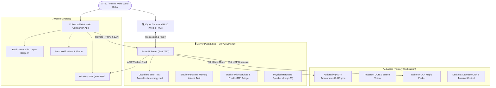

# 🐰 Roborabbit 2.0 — Personal JARVIS AI Operating System

[](https://python.org)
[](https://fastapi.tiangolo.com)
[](https://archlinux.org)
[](https://developer.android.com)
[](https://cloudflare.com)
[](LICENSE)

> **"We are connected to 3 devices: your phone, your main laptop, and this server."**  
> *Roborabbit 2.0* is an autonomous, ultra-fast personal AI assistant inspired by Marvel's **J.A.R.V.I.S.**, designed to seamlessly orchestrate your digital life across your **Laptop**, **Server**, and **Mobile** with hands-free voice, computer control, vision OCR, smart home automation, and proactive executive intelligence.

---

## 🌐 3-Device Ecosystem Topology



---

## ⚡ 16 Complete Feature Domains

### 1. 🧠 Core AI Intelligence
* **Fast Hybrid Decision Engine**: Ultra-fast conversational replies via local FreeLLMAPI with seamless fallback to Cloud LLMs (Gemini 2.5 Flash, Groq Llama 3.3, GPT-4o).
* **Direct Antigravity (AGY) Bridge**: Automatically delegates complex autonomous multi-step coding, downloading, and administration tasks to AGY running on your Laptop.
* **Conversational Long & Short-Term Memory**: Continuous context synchronization so all devices share unified memories of your habits, preferences, and conversations.

### 2. 🎙️ Voice Assistant & Barge-In
* **Wake Word Detection**: Responds instantly to `"Robo"`.
* **Real-Time Turn-Taking & Audio Waveforms**: Interactive canvas visualizer synced with Web Audio API.
* **Barge-In Speech Interruption**: Speak anytime to immediately cut off speech playback and capture your new instruction.
* **Neural Text-to-Speech**: Crystal-clear Microsoft Edge Neural voices (`en-GB-RyanNeural`) and local Piper speech.

### 3. 🖥️ Computer & System Control
* **Cross-Device Execution**: Execute bash commands across `Laptop`, `Server`, and `Mobile` with strict security validation.
* **Application Lifecycle**: Launch, switch, and terminate applications on your workstation (`firefox`, `code`, `alacritty`, `discord`, etc.).
* **Display Blackout**: Instantly turn off server monitors to conserve power with `"screen off"`.
* **Wake-on-LAN (WoL)**: Power on your sleeping laptop remotely over local Wi-Fi.

### 4. 📋 Personal Productivity & Executive Briefings
* **Morning Sitrep & Briefings**: Live weather forecast, today's schedule, unread priority emails, and world headlines compiled into a spoken 1-minute summary.
* **Interactive To-Do Manager**: Add, prioritize, list, and complete tasks (`urgent`, `high`, `medium`, `low`).
* **Calendar Agenda**: Schedule, inspect, and get alerts for upcoming Google Calendar / local events.
* **Cross-Device Timers & Alarms**: Set multi-device countdowns and alarms that sound on hardware speakers or your phone.

### 5. 🌐 Live Internet & Research Radar
* **Real-Time News Aggregator**: Real-time technology, AI, world, and cybersecurity news intelligence.
* **Web Scraping & Fact-Checking**: Extract summaries, clean text, and analyze live web URLs.

### 6. 🏠 Smart Home & IoT Automation
* **Home Assistant & ESP32 Integration**: Voice and HUD controls for lights, switches, AC, and appliances.
* **Lighting Routines**: Turn on/off desk lights, trigger custom ambient scenes, and list device states.

### 7. 📊 System Intelligence & Telemetry
* **Real-Time Hardware Metrics**: CPU load, RAM usage percentage, temperatures, disk space, and battery status polled continuously across all 3 nodes.
* **Docker Container Monitor**: Live stats and container inspection on the Server.

### 8. 🧠 Personal Memory Vault
* **Notes & Semantic Knowledge Base**: Save facts, ideas, passwords (encrypted), and documents into SQLite with full-text search.
* **Memory Editing & Recall**: Ask `"what did I note down about project nexus?"` or `"remember my favorite coffee order"`.

### 9. 💬 Communication Hub
* **Unified Email Client**: Read inbox summaries, star emails, and draft new outbound messages.
* **Phone Notifications Mirroring**: Mirror incoming Android WhatsApp, Calendar, and SMS notifications directly into the HUD.

### 10. 🛠️ Developer Assistant
* **Git Status & Repository Management**: Inspect uncommitted diffs, commit histories, and repo states.
* **Container Management**: Start, stop, and inspect Docker microservices.
* **Linux Administration**: Arch Linux package updates, systemd service inspections, and uptime logs.

### 11. 👁️ Vision & Environmental Awareness
* **Desktop Screen Capture**: Capture active workstation windows and multi-monitor setups.
* **Tesseract OCR**: Read text, terminal code, and error dialogs directly off your screen.

### 12. 🛡️ Security, Privacy & Audit Trail
* **Tamper-Resistant Audit Log**: Every tool execution, bash command, and hardware action is permanently logged with timestamps, exit codes, and latency in SQLite.
* **Emergency Stop (`Esc` Key / Voice)**: Instant hard kill switch that immediately silences audio, drops running tasks, and halts active agents.
* **Local-First Processing**: Sensitive memory and logs remain on your local private nodes.

### 13. 🤖 Advanced Autonomous Capabilities
* **Proactive Status Reports**: Notifies you when devices disconnect, batteries run low, or servers overheat.
* **Multi-Node Task Delegation**: Transparently routes tasks to the best machine for the job.

### 14. 🎛️ Cyber Command HUD Interface
* **Futuristic Cyberpunk UI**: Dark slate & neon cyan theme with glassmorphic modals.
* **Digital Matrix Rain**: Interactive Scempyy digital rain background toggleable with one click.
* **3D Glowing Orb**: State-reactive breathing orb (Listening, Thinking, Speaking, Idle).
* **Cyber Terminal Console**: Interactive in-browser terminal for typing raw cyber commands.

### 15. 📱 Cross-Device Android Companion App
* **Native Android App**: Lightweight Java companion with custom dark cyber rabbit icon.
* **Auto-Discovery & Remote Connect**: Connects via local Wi-Fi or globally via `https://ssh.scempyy.me`.
* **Hardware Controls**: Remote phone vibration, YouTube links, and battery level telemetry.

### 16. 🎭 Roborabbit Personality & Experience
* **JARVIS-Inspired Persona**: Sharp, polite, and concise. Speaks directly and addresses you as *sir*.
* **TTS Optimization**: Ultra-short, conversational replies formatted strictly for clear text-to-speech audio delivery.

---

## 📂 Repository Structure

```
roborabbit-2.0/
├── agent.py               # Multi-model LLM hybrid router, AGY bridge & tool registry
├── server.py              # FastAPI application, WebSocket streaming & REST endpoints
├── tools.py               # Cross-device execution, hardware diagnostics & IoT handlers
├── database.py            # SQLite database schema, memory vault & audit logging
├── tts.py                 # Neural TTS speech synthesis & hardware speaker broadcasting
├── config.py              # Persistent configuration & hardware target definitions
├── requirements.txt       # Python dependencies
├── .env.example           # Environment variables template
├── android/               # Native Android Companion App project
│   ├── AndroidManifest.xml
│   ├── Roborabbit.apk     # Pre-built installable APK package
│   ├── res/               # Android layouts, cyber drawables, and launcher icons
│   └── src/               # Java Android companion source code
├── static/                # Cyber Command Web HUD & PWA assets
│   ├── index.html         # Cyberpunk dashboard & control panels
│   ├── app.js             # Visualizers, barge-in voice engine & terminal logic
│   ├── manifest.json      # Progressive Web App manifest
│   ├── icon-192.png       # Neon rabbit cyber icon (192x192)
│   └── icon-512.png       # Neon rabbit cyber icon (512x512)
└── systemd/               # Linux service configuration
    └── roborabbit.service # Always-on systemd service unit
```

---

## 🚀 Quick Start Guide

### 1. Server Setup (Arch Linux / Ubuntu)

```bash
# Clone the repository
git clone https://github.com/Scempyyy/roborabbit-2.0.git
cd roborabbit-2.0

# Create and activate virtual environment
python3 -m venv venv
source venv/bin/activate

# Install dependencies
pip install -r requirements.txt

# Configure environment
cp .env.example .env
# Edit .env with your network IPs and optional API keys

# Launch Roborabbit Server
uvicorn server:app --host 0.0.0.0 --port 7777
```

Access the **Cyber Command HUD** locally at `http://localhost:7777` or globally via your Cloudflare Tunnel.

### 2. Android Companion App Installation

1. Navigate to the `android/` directory.
2. Install `Roborabbit.apk` onto your Android phone via ADB:
   ```bash
   adb install android/Roborabbit.apk
   ```
3. Open the app, grant Microphone permissions, and connect to `https://ssh.scempyy.me` or your local server IP.

### 3. Running as a 24/7 Systemd Service

```bash
sudo cp systemd/roborabbit.service /etc/systemd/system/
sudo systemctl daemon-reload
sudo systemctl enable --now roborabbit.service
```

---

## ⌨️ Primary Cyber Commands

| Command | Action |
|---|---|
| `status` | Full telemetry and battery status across Laptop, Server, Mobile |
| `briefing` | Executive morning sitrep with weather, agenda, and headlines |
| `wake laptop` | Broadcasts Wake-on-LAN magic packet to turn on workstation |
| `screen off` | Puts the server display to sleep to save power |
| `docker` | Displays live Docker container statistics |
| `run on laptop: <cmd>` | Executes shell command on main workstation |
| `run on server: <cmd>` | Executes bash command on server node |
| `run on mobile: <cmd>` | Executes Android shell command via wireless ADB |
| `announce <text>` | Broadcasts voice announcement through hardware speakers |
| `lights on` / `lights off` | Toggles smart desk lighting via IoT integration |
| `Esc` / `"emergency stop"` | Immediately halts speech and terminates active tasks |

---

## 📄 License

This project is licensed under the [MIT License](LICENSE).

---

*Engineered with precision for autonomous computing.* 🐰⚡
